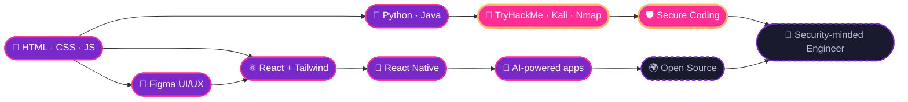

<!-- ═══════════ MATRIX / CYBER-TERMINAL THEME ═══════════ -->
<div align="center">


<br/><br/>


<br/>


</div>

<br/>


## 🎮 &nbsp;PLAYER CARD

<table align="center">
<tr>
<td width="55%" valign="top">

```yaml
PLAYER ........ Chithaa Madanayake
CLASS ......... Frontend Mage
SUBCLASS ...... Ethical Hacker
REALM ......... Sri Lanka
GUILD ......... The Self-Taught
LEVEL ......... ∞  (always grinding)
WEAPON ........ React + Tailwind
SHIELD ........ Cybersecurity mindset
PET ........... A cup of coffee ☕
SOUNDTRACK .... Late-night lo-fi 🌙
MOTTO ......... "One pixel, one scan at a time."
```

</td>
<td width="45%" valign="top">

```text
❤️  HP        ▰▰▰▰▰▰▰▰▰▰  Unbreakable
☕  MANA      ▰▰▰▰▰▰▰▱▱▱  Refilling…
⚡  XP        ▰▰▰▰▰▰▰▰▱▱  Leveling up
🎨  CREATIVITY ▰▰▰▰▰▰▰▰▰▱
🧠  LOGIC      ▰▰▰▰▰▰▰▰▱▱
🕵️  STEALTH    ▰▰▰▰▰▰▱▱▱▱  (growing)
🔥  CURIOSITY  ▰▰▰▰▰▰▰▰▰▰
```

</td>
</tr>
</table>

<div align="center">

> *“I build things that feel human, then learn how they break so I can keep them safe.”*

</div>


## 📜 &nbsp;PROFILE.JS

```js
const chithaa = {
  alias: "Chithaa",
  from: "Sri Lanka 🇱🇰",
  roles: ["Frontend Developer", "UI/UX Designer", "Ethical Hacker", "Digital Artist"],
  stack: {
    build:  ["React", "React Native", "Tailwind", "Node.js"],
    cloud:  ["Firebase", "Supabase", "Vercel", "Netlify"],
    design: ["Figma", "Digital art"],
    defend: ["TryHackMe", "Kali Linux", "Nmap"],
  },
  currentlyLearning: ["Secure coding", "Networking", "Linux internals"],
  weekend: "drawing digital art & UI concepts",
  openTo: ["collabs", "big ideas"],
};

while (alive) {
  design();
  code();
  hackLegally();
  sleep(false); // limits not found, skipping
}
```


## 🎒 &nbsp;INVENTORY

<div align="center">

<br/>


<br/><br/>

   

    

   

     

   

</div>


## 🌳 &nbsp;SKILL TREE



<div align="center">

<sub>🟣 unlocked &nbsp;·&nbsp; 🩷 in progress &nbsp;·&nbsp; ⬛ locked, coming soon</sub>

</div>


## 🗺️ &nbsp;QUESTS COMPLETED

<table>
<tr>
<td width="50%" valign="top">

### 🕵️ [Agent X](https://agent-x-zeta.vercel.app/)
 

A personal safety app that **detects hidden surveillance** using AI.

 

</td>
<td width="50%" valign="top">

### 💸 [WalletWatch](https://www.linkedin.com/feed/update/urn:li:activity:7214636530487709696/)
 

A modern budgeting app with a sleek, intuitive interface.

 

</td>
</tr>
<tr>
<td width="50%" valign="top">

### 🎶 [MelooMood](https://drive.google.com/file/d/1V7KVcRNqub8l880Rp_IryKSuv-kllus-/view)
 

A mood-based playlist generator powered by **emotion detection**.

 

</td>
<td width="50%" valign="top">

### 🖥️ [Supra Marketing Web](https://www.linkedin.com/feed/update/urn:li:activity:7321896235160735744/)
 

A business-ready, fully responsive marketing website.

  

</td>
</tr>
<tr>
<td colspan="2" valign="top">

### 🧪 [Side Quest: CMD Script Lab](https://github.com/ChithaaMadanayake/viruses)


For fun and learning: safe command-line script experiments.

</td>
</tr>
</table>


## 📊 &nbsp;LIVE PLAYER STATS

<div align="center">


<br/>


<br/><br/>


<br/>


</div>


## 🏆 &nbsp;ACHIEVEMENTS

- [x] 🕵️ **Surveillance Slayer**: built an AI app that detects hidden surveillance (Agent X)
- [x] 💸 **Pixel Perfectionist**: designed and shipped a budgeting app (WalletWatch)
- [x] 🎶 **Mind Reader**: taught an app to understand emotions (MelooMood)
- [x] 🖥️ **Client Whisperer**: delivered a business website (Supra Marketing)
- [x] 🌙 **Night Owl**: fuelled by lo-fi and coffee
- [ ] 🛡️ **Packet Wizard**: finish more TryHackMe learning paths
- [ ] 🌍 **Community Hero**: contribute to open source
- [ ] 🚀 **Legend Status**: launch the next big thing


## 📖 &nbsp;THE CODE OF HONOUR

```diff
+ Learn it. Practice it legally. Defend with it.
+ Respect privacy. Protect people. Share what you know.
- Never test systems you don't own or have permission to test.
- Never use skills to harm, harass, or steal.
```

<details>
<summary><b>🕹️ CHEAT CODE: click to unlock a secret</b></summary>

<br/>

```text
↑ ↑ ↓ ↓ ← → ← → B A   ✔ CODE ACCEPTED

+ Secret #1  I name variables seriously, then rename them at 2 AM.
+ Secret #2  The best bugs are the ones that teach you something.
+ Secret #3  Dark mode isn't a preference. It's a lifestyle.
+ Secret #4  Lo-fi + terminal + a fresh idea = unstoppable.

+30 XP  ·  Thanks for digging through my profile 💜
```

</details>


## 📡 &nbsp;SEND A MESSAGE TO PLAYER ONE

<div align="center">

**💬 Ask me about:** `Web Dev` · `Cybersecurity` · `UI/UX` · `Digital Art` · `Life`

<br/>

<a href="https://chithaamadanayake.vercel.app/"></a>
<a href="https://www.linkedin.com/in/chithaa-mithmaa-madanayake-a3814a293"></a>
<a href="https://tryhackme.com/p/here..cta"></a>
<a href="mailto:chithaa.20244018@iit.ac.lk"></a>

<br/><br/>


</div>


