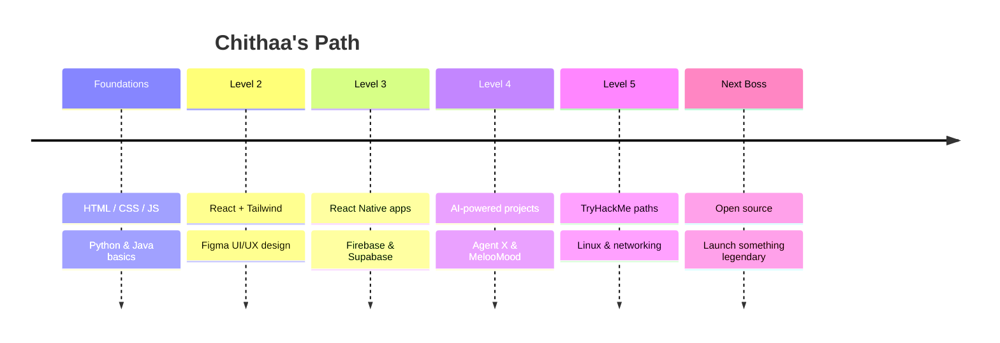

<!-- ═══════════ CHITHAA // MATRIX CYBER-TERMINAL PROFILE v2.0 ═══════════ -->
<div align="center">


<br/>


</div>

<br/>

```ansi
   ██████╗██╗  ██╗██╗████████╗██╗  ██╗ █████╗  █████╗
  ██╔════╝██║  ██║██║╚══██╔══╝██║  ██║██╔══██╗██╔══██╗
  ██║     ███████║██║   ██║   ███████║███████║███████║
  ██║     ██╔══██║██║   ██║   ██╔══██║██╔══██║██╔══██║
  ╚██████╗██║  ██║██║   ██║   ██║  ██║██║  ██║██║  ██║
   ╚═════╝╚═╝  ╚═╝╚═╝   ╚═╝   ╚═╝  ╚═╝╚═╝  ╚═╝╚═╝  ╚═╝
        "Wake up, Neo... the pixels have you."
```

## `>_ BOOT SEQUENCE`

```bash
[  OK  ] Loading identity .............. Chithaa Madanayake
[  OK  ] Loading location .............. Sri Lanka 🇱🇰
[  OK  ] Loading roles ................. Frontend Dev · UI/UX Designer · Ethical Hacker · Digital Artist
[  OK  ] Loading fuel .................. Caffeine ☕ + late-night lo-fi 🌙
[  OK  ] Loading mindset ............... Self-taught · Curious · Unstoppable
[  OK  ] Loading mission ............... "One pixel and one scan at a time."
[  OK  ] Mounting /dev/creativity ...... done
[  OK  ] Starting service: debug-and-dream.service
[ WARN ] Limits not found .............. skipping...
[  OK  ] System ready. Welcome to my world.
```

---

## `>_ WHOAMI`

```bash
chithaa@matrix:~$ neofetch

   ┌──────────────────────────────────────────────────────┐
   │  OS ........... Self-Taught v2026 (stable, caffeinated)│
   │  HOST ......... Sri Lanka 🇱🇰                           │
   │  KERNEL ....... Curiosity 6.9-unstoppable              │
   │  SHELL ........ zsh + dreams                           │
   │  UI ........... React + Tailwind + Figma               │
   │  DEFENCE ...... Learning how things break, to fix them │
   │  OFFENCE ...... Legal only. TryHackMe & labs.          │
   │  HOBBIES ...... Digital art, UI concepts, lo-fi        │
   │  UPTIME ....... Since the first "Hello, World!"        │
   └──────────────────────────────────────────────────────┘
```

<table align="center">
<tr>
<td width="50%" valign="top">

### 🧠 Who I am
A **self-taught creative thinker** with two obsessions: making interfaces that feel human, and learning how systems break so I can defend them.

Logic + aesthetic. Code + art. Offence + defence.

</td>
<td width="50%" valign="top">

### ⚡ Right now
- 🎨 Building sleek UIs with **React + Tailwind**
- 📱 Shipping mobile apps with **React Native**
- 🔐 Levelling up on **TryHackMe**
- 🖌️ Drawing digital art & UI on weekends
- 🌱 Learning: **secure coding, networking, Linux internals**

</td>
</tr>
</table>

---

## `>_ TECH_ARSENAL`

<div align="center">

<br/>


<br/><br/>

   

    

   

     

   

</div>

### 📊 Skill levels

```text
React / Tailwind ..... [██████████████████░░]  90%
JavaScript ........... [█████████████████░░░]  85%
UI / UX (Figma) ...... [█████████████████░░░]  85%
React Native ......... [███████████████░░░░░]  75%
Python ............... [██████████████░░░░░░]  70%
Firebase / Supabase .. [██████████████░░░░░░]  70%
Linux & CLI .......... [█████████████░░░░░░░]  65%
Ethical Hacking ...... [████████████░░░░░░░░]  60%  ← levelling up daily
Java ................. [████████████░░░░░░░░]  60%
```

---

## `>_ MISSIONS_COMPLETED`

<table>
<tr>
<td width="50%" valign="top">

### 🔐 [Agent X](https://agent-x-zeta.vercel.app/)
Personal safety app that **detects hidden surveillance** using AI.

  

</td>
<td width="50%" valign="top">

### 💸 [WalletWatch](https://www.linkedin.com/feed/update/urn:li:activity:7214636530487709696/)
Modern budgeting app with a sleek, intuitive UI.

 

</td>
</tr>
<tr>
<td width="50%" valign="top">

### 🎶 [MelooMood](https://drive.google.com/file/d/1V7KVcRNqub8l880Rp_IryKSuv-kllus-/view)
Mood-based playlist generator using **emotion detection**.

 

</td>
<td width="50%" valign="top">

### 🖥️ [Supra Marketing Web](https://www.linkedin.com/feed/update/urn:li:activity:7321896235160735744/)
Business-ready, fully responsive marketing website.

  

</td>
</tr>
<tr>
<td colspan="2" valign="top">

### 🧪 [CMD Script Lab](https://github.com/ChithaaMadanayake/viruses)
For fun & learning: safe CMD script experiments.

</td>
</tr>
</table>

<div align="center">

<a href="https://github.com/ChithaaMadanayake/viruses"></a>

</div>

---

## `>_ LIVE_STATS`

<div align="center">


<br/>


<br/><br/>


<br/>


</div>

### 🐍 Snake eating my contributions

<div align="center">

<!-- Needs the snake workflow (see snake.yml). Works once the Action has run once. -->
<picture>
  <source media="(prefers-color-scheme: dark)" srcset="https://raw.githubusercontent.com/ChithaaMadanayake/ChithaaMadanayake/output/github-snake-dark.svg" />
  <source media="(prefers-color-scheme: light)" srcset="https://raw.githubusercontent.com/ChithaaMadanayake/ChithaaMadanayake/output/github-snake.svg" />
  
</picture>

</div>

---

## `>_ MISSION_LOG`

- [x] 🔐 Build a surveillance-detection app (**Agent X**)
- [x] 💸 Design & ship a budgeting app (**WalletWatch**)
- [x] 🎶 Teach an app to read emotions (**MelooMood**)
- [x] 🖥️ Deliver a business website (**Supra Marketing**)
- [ ] 🛡️ Complete more TryHackMe learning paths
- [ ] 🌍 Contribute to open-source
- [ ] 🚀 Launch the next big thing

---

## `>_ ROADMAP_2026`



---

## `>_ PHILOSOPHY`

<div align="center">


</div>

---

## `>_ CYBER_CODE`

```diff
+ Learn it. Practice it legally. Defend with it.
+ Respect privacy. Protect users. Share knowledge.
- Never test systems you don't own or have permission to test.
- Never use skills to harm, harass, or steal.
```

<details>
<summary><b>🔓 sudo access — click to reveal hidden file</b></summary>

<br/>

```bash
chithaa@matrix:~$ sudo cat /secrets.txt
[sudo] password for chithaa: ********

> Secret #1: I name my variables seriously, then rename them at 2 AM.
> Secret #2: The best bugs are the ones that teach you something.
> Secret #3: Dark mode isn't a preference. It's a lifestyle.
> Secret #4: Lo-fi + terminal + a fresh idea = unstoppable.

chithaa@matrix:~$ echo "Thanks for visiting 💚"
Thanks for visiting 💚
```

</details>

---

## `>_ CONNECT`

<div align="center">

**💬 Ask me about:** `Web Dev` · `Cybersecurity` · `UI/UX` · `Digital Art` · `Life`

<br/>

<a href="https://chithaamadanayake.vercel.app/"></a>
<a href="https://www.linkedin.com/in/chithaa-mithmaa-madanayake-a3814a293"></a>
<a href="https://tryhackme.com/p/here..cta"></a>
<a href="mailto:chithaa.20244018@iit.ac.lk"></a>

<br/><br/>


</div>


